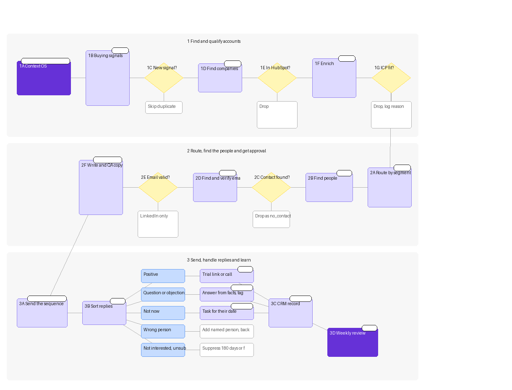

# Formplus outbound GTM system

**Status: v1 design, 2026-11-13. Work in progress.** Nothing here is built yet.

Built from `context/icp/` ([icp.md](../icp/icp.md), [personas.md](../icp/personas.md), [signal-matrix.md](../icp/signal-matrix.md)) and the playbooks in `knowledge-base/playbooks/`. Company facts are cited in those files; this doc points to them.

**Labels**
- **PLAYBOOK**: a rule or benchmark already in `knowledge-base/playbooks/`.
- **PROPOSED**: a threshold or rule this design sets. It's INFERRED, so tune it after the first cycle.
- **OPEN**: a decision or fact we don't have yet.

## The system on one page

```
0 Context OS (repo)            what we sell, to whom, which signals are live
        |
1 Buying signals (Clay)        W1 Google Forms/paper, W2 events, W3 NG school form sales, W4 hiring
        |
2 Find companies (Clay)        one Companies table, deduped against HubSpot
        |
3 Enrich (Clay)                firmographics, site crawl, payment stack, event details
        |
4 ICP fit check (Clay AI)      segment A-US / A-NG / B / D / E, or not a fit + reason
        |
5 Route by segment (Clay)      segment x signal -> campaign, persona, proof, CTA path
        |
6 Find people (Apollo)         champion and/or economic buyer by segment
        |
7 Emails (Clay waterfall)      find -> verify -> valid / catch-all / none
        |
8 Sequence                     Instantly email + LinkedIn DMs, paused on reply
        |
9 Reply handling (n8n)         classify -> trial link or call -> HubSpot
        |
10 CRM (HubSpot)               system of record, suppression back to step 2
        |
11 Weekly feedback (n8n + review)  learnings file, ICP and signal status updates -> back to 0
```

### Flow chart



Source: [diagrams/formplus-gtm-system.json](../../diagrams/formplus-gtm-system.json) (spec) and [diagrams/formplus-gtm-system.svg](../../diagrams/formplus-gtm-system.svg) (vector), built with the `miro-gtm-flowchart` skill. Two simplifications: the step 8 QA and owner approval gate sits inside the copy step, and out-of-office replies are left out. Miro board: not created yet (the Miro MCP server did not connect).

---

## Step 0: Context OS

**What happens:** every workflow reads its targeting and rules from the repo before it runs, so changes in one place flow to every build.

**Tool:** this repo (Git). Clay prompts and n8n flows copy their inputs from these files.

| File | What the system takes from it |
|---|---|
| `context/icp/icp.md` | Segment definitions, not-a-fit rules, plan fit |
| `context/icp/personas.md` | Job titles per persona, pains in their words, objections |
| `context/icp/signal-matrix.md` | Signal list, status (live, test, killed), workflow numbers W1 to W8 |
| `context/docs/research/` | Proof points and quotes, each with a source |
| `knowledge-base/playbooks/` | Copy rules, cadence, benchmarks, Clay build rules |
| `knowledge-base/learnings/` | What worked and what didn't (written in step 11) |
| `weekly-priorities/`, `work-log/` | This week's focus; record of every change |

**Decisions**

| Question | Answer: leads to |
|---|---|
| Is the signal's status "live" in Matrix 3? | Yes: the workflow runs. Test: runs at a capped volume (PROPOSED: one campaign, one segment). Killed or paused: does not run |
| Is the segment's priority High or Medium in icp/signal-matrix? | High or Medium: in scope for v1 (A-US, A-NG, B, D, E). Low (C, F) or test cell (NGO M&E): held, not run in v1 |
| Did the ICP or matrix change since the last build? | Yes: re-copy the changed rules into the Clay prompt and routing table before the next run, and log it in `work-log/` |

---

## Step 1: Buying signals

**What happens:** scheduled Clay sources look for companies showing a live signal. The signal comes first, then the ICP filter (PLAYBOOK, signal-matrix-framework guardrails).

**Tool:** Clay (sources, HTTP, Claygent), with BuiltWith, Apify and crawl4ai feeding it.

| Workflow | Signal (Matrix 2) | Source | Run frequency |
|---|---|---|---|
| W1 | S2 Google Forms on site + S3 paper process | BuiltWith Google Forms list via Clay; crawl4ai or Claygent page scan | Monthly for the BuiltWith pull (PLAYBOOK: tech adoption monthly); weekly page re-scan of new rows |
| W2 | S4 Recurring event, conference, competition or paid training | Eventbrite via Apify; org events pages | Weekly |
| W3 | S1 Nigerian school form sales | Nigerian education news and school pages; JAMB bulletins | Weekly during admission season (PROPOSED: March to September, from the dates in market.md); monthly otherwise |
| W4 | S5 Hiring admissions, admin, ops or event roles | Clay Find Jobs; Indeed via Apify; MyJobMag for Nigeria | Weekly (PLAYBOOK: job postings weekly) |

**Decisions**

| Question | Answer: leads to |
|---|---|
| Did the signal fire for this company? | Yes: new row to step 2. No: nothing |
| Is it new since the last run? | Yes: continue. Same signal already logged: skip (dedupe on domain + signal + date) |
| W1 only: does a Google Forms hit sit on a page asking for documents or payments? | Yes: strong W1 row. No (e.g. a newsletter sign-up): drop it. W1 is a compound signal (signal-matrix S2) |
| W2 only: does the event already use a ticketing checkout? | Google Forms, bank transfer or email registration: keep. Checkout already built in: drop (signal-matrix S4 filter) |
| W3 only: is the fee paid by bank transfer or on paper? | Yes: keep, and flag `payment_method` for copy. Online portal already: keep but route to the "applications and documents" angle, not payments |

---

## Step 2: Find companies

**What happens:** every signal row lands in one Clay Companies table with a clean domain and its source recorded.

**Tool:** Clay (Companies table), checked against HubSpot.

**Decisions**

| Question | Answer: leads to |
|---|---|
| Does the row have a working domain? | Yes: continue. No: Clay "Find company website" once; still none: drop and log `no_domain` |
| Is the company already in HubSpot as a customer, open deal or suppressed? | Customer: drop from outbound (OPEN: send to an expansion list instead?). Open deal: drop, notify the deal owner. Suppressed or unsubscribed: drop. Not in HubSpot: continue |
| Was it contacted in the last 90 days? | Yes: drop, unless the signal is different and newer (PLAYBOOK: suppress, allow re-entry on a new signal). PROPOSED: 90 days |
| Is it a Formplus case-study customer (seed list)? | Yes: drop from outbound; keep it as a lookalike seed (signal-matrix S9) |

---

## Step 3: Enrichment

**What happens:** cheap checks first, then paid enrichment only on rows that pass (PLAYBOOK: filter before enriching; Clay iron laws).

**Tool:** Clay (Apollo company data via Clay, Claygent, HTTP, BuiltWith).

| Order | Enrichment | Feeds |
|---|---|---|
| 1 | Firmographics: industry, headcount, country (Apollo via Clay) | Step 4 fit check |
| 2 | Page scan: Google Forms links, PDF or Word forms, "send proof of payment", "email your documents", WhatsApp order links | Step 4 and copy line 1 |
| 3 | Payment stack: Paystack, Flutterwave, Stripe, PayPal (BuiltWith) | Segment E check, copy |
| 4 | Signal detail: event name and date (W2), form fee and deadline (W3), job title and post date (W4) | Copy line 1, send timing |

**Decisions**

| Question | Answer: leads to |
|---|---|
| Did firmographics come back? | Yes: continue. No: run page scan only; if the site shows a clear segment (school, nonprofit, shop), continue; else drop as `thin_data` |
| Is the country inside v1 markets? | US, Nigeria, Kenya: continue. Elsewhere: hold (PROPOSED for v1; customers exist in the UK, Finland and India too (customers.md), so this can widen later) |
| Did the page scan find nothing for a W1 row? | Drop: the signal didn't hold |

---

## Step 4: ICP fit check

**What happens:** one Clay AI column assigns a segment or a not-a-fit reason, using the rules in icp.md. Built with `prompt-builder` and tested on real rows before scale (PLAYBOOK: Clay iron laws, prove on one row first).

**Tool:** Clay (Use AI column, JSON output: `segment`, `fit_reason`, `not_fit_reason`, `confidence`).

**Decisions**

| Question | Answer: leads to |
|---|---|
| Does it match a v1 segment? | A-US, A-NG, B, D or E: to step 5. C or F: hold list (Low priority). NGO M&E: test cell only, capped |
| Does it hit a not-a-fit rule? | Consumer or personal use; healthcare handling patient data (no HIPAA claim); enterprise needing SOC 2, ISO, DPA or data residency; large-scale offline field collection; Microsoft 365 internal-only surveys; design-led marketing forms. Any yes: drop with `not_fit_reason` written to the row (feeds step 11) |
| Is confidence low? | PROPOSED: below "high", send to a manual review view; a person checks a sample each week; the rest are dropped, not guessed |
| Plan fit (for copy and CTA) | Payments needed: Starter or above (payments locked on Free). Recurring dues: Professional (Stripe subscriptions). School or nonprofit: mention the 10% discount [icp.md plan reference] |

---

## Step 5: Route by segment

**What happens:** each fit row gets one route: which campaign, which persona to find, which proof story, and which reply path it will default to. Routing is a Clay lookup table, so adding a segment is a new row, not a new build.

**Tool:** Clay (routing table + formula column). n8n pushes leads to the matching Instantly campaign in step 8.

| Segment | Persona to find (step 6) | Proof story (from customers.md) | Angle source | Default positive-reply path (step 9) |
|---|---|---|---|---|
| A-US schools | Champion first; economic buyer second | Polk State, COTSA | Matrix 1, row A | Call |
| A-NG schools | Champion first; economic buyer second | Polk State (no Nigerian school story yet) | Matrix 1, row A | Call |
| B nonprofits | Champion; economic buyer if under ~20 staff (PROPOSED) | AASHE, Ruby's Place | Matrix 1, row B | Trial if small, call if large |
| D service SMBs | Founder or owner (same person) | Motive, Watamu, Yellow Dandelion | Matrix 1, row D | Trial |
| E African SMEs | Founder or owner (same person) | Beauty Bar Group, Watamu | Matrix 1, row E | Trial |

**Decisions**

| Question | Answer: leads to |
|---|---|
| Which signal fired? | W1: "Google Forms or paper" campaign. W2: "event registration" campaign. W3: "school form sales" campaign. W4: secondary line only (stacked onto W1 to W3), not its own campaign in v1 (signal-matrix top signals) |
| More than one signal on the same company? | Use the highest-ranked one as the mother intent (W1 > W2 > W3 > W4); the others become copy line 2 (PLAYBOOK: conditional waterfall) |
| Is there a proof story for this segment? | Yes: use it. No: skip the proof line (PLAYBOOK: generic proof is worse than none) |

---

## Step 6: Find people

**What happens:** find the right person or people at each routed company.

**Tool:** Apollo (people search by company domain + title keywords from personas.md). Clay Claygent is the fallback.

| Segment | Titles to search (personas.md) |
|---|---|
| A | Admissions officer, registrar, instructional technologist, operations coordinator; then principal, head of school, bursar (OPEN: approver title not in research) |
| B | Program, membership, events or data manager; then executive director, COO |
| D, E | Founder, owner, CEO, director |

**Decisions**

| Question | Answer: leads to |
|---|---|
| Champion found? | Yes: primary contact. No: try the economic buyer. Neither: Claygent on the site's team or contact page; still none: drop as `no_contact` |
| Large organisation (A, larger B)? | Up to 2 contacts: champion and economic buyer, staggered, never the same day (PROPOSED). Small (D, E): 1 contact only |
| LinkedIn profile URL found? | Yes: eligible for the LinkedIn step. No: email only |

---

## Step 7: Find and verify emails

**What happens:** Clay email waterfall, then a verification gate before anything reaches Instantly.

**Tool:** Clay waterfall: Prospeo, then Icypeas, then Leadmagic, then Findymail; then Bounceban to verify (PLAYBOOK: Clay expert, recommended order; stops on first match; always validate after).

**Decisions**

| Verification result | Leads to |
|---|---|
| Valid | To Instantly (step 8) |
| Catch-all or risky | PROPOSED: LinkedIn-only if a profile exists; otherwise a separate low-volume Instantly campaign so it can't hurt the main domain's bounce rate |
| Invalid or not found | LinkedIn-only if a profile exists; otherwise drop as `no_email` |
| Bounce rate on a live campaign goes over 3% | Pause the campaign and check the list (PLAYBOOK: copy-frameworks bounce target under 3%) |

---

## Step 8: Sequence (email and LinkedIn)

**What happens:** each contact gets an email sequence and, if eligible, two LinkedIn DMs. Copy is written with `campaign-copy` from the approved workflow spec and checked with `campaign-qa`.

**Tools:** Instantly (email). LinkedIn (connection request and DMs; OPEN: send by hand or with an automation tool, not chosen yet). n8n moves leads between them.

| Day | Channel | Step | Rule |
|---|---|---|---|
| 0 | Email 1 | Earn the reply: the signal, in their situation | PLAYBOOK: one question CTA, under 120 words |
| 1 to 2 | LinkedIn | Connection request, no note | PLAYBOOK: empty request by default |
| 3 to 4 | Email 2 | New value: matched proof story or a ready template | PLAYBOOK: each touch adds something new |
| 1 to 2 days after accept | LinkedIn DM 1 | One question, reads like a text | PLAYBOOK |
| 3 to 5 days after DM 1 | LinkedIn DM 2 | Context and a soft offer. No DM 3 | PLAYBOOK |
| 7 to 10 | Email 3 | New angle or "right person?" | PLAYBOOK |
| 14+ (optional) | Email 4 | Close the loop or ask for a referral | PLAYBOOK |

Copy rules that apply to Formplus specifically:
- No em dashes (CLAUDE.md).
- Don't claim NDPA compliance, SOC 2 or HIPAA; none are stated (company.md).
- Don't pitch offline to segment C or as a headline to anyone while it's labelled "(beta)" (icp.md).
- Use the proof story that matches the segment (step 5).

**Decisions**

| Question | Answer: leads to |
|---|---|
| Has the campaign passed `campaign-qa` and been approved by the owner? | Yes: launch. No: don't send (CLAUDE.md: ask before sending anything) |
| Did the contact reply on either channel? | Yes: pause the other channel now, go to step 9 (PLAYBOOK: pause on reply) |
| LinkedIn request not accepted in 2 weeks? | Withdraw; email continues (PLAYBOOK) |
| Daily LinkedIn volume | Max 20 to 30 connection requests per account per day (PLAYBOOK) |

---

## Step 9: Reply handling

**What happens:** every reply is classified and acted on within the working day.

**Tool:** n8n (Instantly reply webhook and LinkedIn replies in; AI classify node; writes to HubSpot; drafts responses for a person to send).

| Reply category | Action |
|---|---|
| Positive | Go to the trial-or-call decision below |
| Question about features, price or security | Draft an answer from research facts only; anything Not found (SOC 2, NDPA, hosting, file limits) goes to a person, never guessed |
| Objection | Tag it in HubSpot (price, free alternative, design, compliance, already on KoboToolbox); draft a reply; feeds step 11 |
| Not now | Stop the sequence; set a HubSpot task for the date they give, or the next season for schools (PROPOSED) |
| Wrong person or referral | Add the named person in Clay at step 6; reference the referrer |
| Not interested | Stop; suppress for 180 days (PROPOSED) |
| Unsubscribe | Stop; suppress permanently in Instantly and HubSpot |
| Out of office | Pause; resume on the return date |

### Decision: positive reply goes to a free trial link or a call

Formplus is self-serve: free to start, "No credit card required", paid plans from $20 to $25 a month (company.md). Most small buyers can start alone. A call is worth it only where a call changes the outcome.

| Send the **trial link + ready template** when | Book a **call** when |
|---|---|
| Segment D or E, or a small B (one person is champion and buyer, personas.md) | Segment A, or a larger B, where someone else approves spend (personas.md) |
| The signal names one clear use case (event registration, order form, application) | They ask about security, compliance, NDPA, SSO or data location (answers are Not found, so a person must handle them) |
| No question that needs a person | They need more than 20 members, Enterprise volume or custom features (company.md plan limits) |
| They don't ask for a call | They ask for a call, or mention several teams or use cases |

| Path | What it leads to |
|---|---|
| **Trial** | n8n sends a reply with the signup link and the template that fits the signal: Event Registration, Membership Registration, Camp Registration or Vendor Registration (registration-forms page); order templates for florists, cakes or delivery (order-forms page); an application template for schools (OPEN: no admissions template is named in research). HubSpot: contact to "Trial sent". If no signup in 3 days, one follow-up with a short how-to; if no signup in 7 days, offer a call (PROPOSED timings). OPEN: Formplus must send signup events to HubSpot, or the trial path can't be tracked (see risks) |
| **Call** | n8n sends a booking link; on booking, HubSpot creates a deal at "Meeting booked" with segment, signal and objection notes. The call ends in a trial set up together, an Enterprise quote via the contact form, or closed lost with a reason |

---

## Step 10: CRM

**What happens:** HubSpot is the system of record. Clay and n8n write to it; step 2 reads its suppression and deal data back.

**Tool:** HubSpot.

| Object | Properties this system writes |
|---|---|
| Company | `segment`, `signal` (W#), `signal_date`, `icp_fit_reason` or `not_fit_reason`, `plan_fit`, `country` |
| Contact | `persona` (champion, economic buyer, influencer), `campaign`, `channel`, `reply_category`, `objection_tag`, `cta_path` (trial or call), `trial_sent_date`, `signup_date` (OPEN) |
| Deal (calls only) | Stage, segment, signal, plan discussed, closed-lost reason |

**Decisions**

| Question | Answer: leads to |
|---|---|
| Does the contact or company already exist? | Yes: update, don't duplicate (match on domain and email). No: create |
| Positive reply on the call path? | Create a deal. Trial path: no deal until signup or payment (PROPOSED, keeps the pipeline honest) |
| Unsubscribe or hard bounce? | Mark suppressed; Clay step 2 drops them on the next run |

---

## Step 11: Weekly feedback loop

**What happens:** every week, n8n pulls results by workflow, segment, persona and angle, a person reviews them, and the findings change the Context OS.

**Tools:** n8n (weekly job: Instantly and HubSpot data into a summary), then a weekly review; results written to the repo.

| Metric | Target (PLAYBOOK, copy-frameworks) |
|---|---|
| Positive reply rate | 2 to 8% |
| Reply rate | 5 to 15% |
| Bounce rate | Under 3% |
| Unsubscribe rate | Under 0.5% |
| Trial signups per trial link sent | OPEN: no benchmark in the playbooks; set after the first month |

**Decisions**

| Question | Answer: leads to |
|---|---|
| Fewer than 200 sends for a variant? | No decision yet (PLAYBOOK: 200+ sends per variant before judging) |
| Bounce over 3% or unsubscribes over 0.5%? | Fix list quality or targeting first, before touching copy (PLAYBOOK) |
| Positive reply rate under 2% for a segment after 200+ sends? | Write the finding to learnings. PROPOSED: two weeks in a row moves the segment down one priority in icp.md and signal-matrix.md |
| A signal produces volume but no positive replies? | Set its status to "paused" in Matrix 3; after a second test with new copy, "killed" with the reason in Matrix 2 |
| The same `not_fit_reason` keeps appearing? | Add or tighten the rule in icp.md's not-a-fit list and in the step 4 prompt |
| A new objection keeps appearing? | Add it to personas.md objections, with the reply quote as evidence |
| A segment or angle beats target? | Write why in learnings; raise its priority; consider a lookalike build from the new customers (signal-matrix S9) |

**What gets written each week**
- `knowledge-base/learnings/YYYY-Www.md`: what worked, what didn't, and why, with the numbers and the campaign names.
- `context/icp/icp.md`, `personas.md`, `signal-matrix.md`: only when a decision above says so, with the date and the evidence.
- `work-log/YYYY-Www.md`: every change made (CLAUDE.md rule).
- Step 0 then picks up the new rules for the next run.

---

## Check against the four pillars

| Pillar | Where the design delivers it | Gap |
|---|---|---|
| **Clean data** | One Companies table; dedupe on domain and email; HubSpot suppression read back (steps 2, 10); ICP gate before paid enrichment (steps 3, 4); email verification gate and 3% bounce stop (step 7); not-fit reasons stored, not discarded | Catch-all handling and the low-confidence review are PROPOSED and untested |
| **Always-on signals** | W1 to W4 on fixed schedules matched to how fast each signal changes (step 1); dedupe so only new signals enter | W3 is seasonal by nature; W1's BuiltWith pull is monthly, so it's slower |
| **Composable workflows** | 7 of 10 live signals share one build with keyword swaps (signal-matrix 2b); segments, personas and proof stories sit in one routing table (step 5); adding a segment is a row, not a rebuild | W3 (Nigerian schools) and S6 (African payments) need their own builds |
| **Tight feedback loops** | Reply categories and objection tags in HubSpot (step 9); weekly metrics against playbook targets; set rules that change icp.md, personas.md and signal-matrix.md (step 11) | Trial-path conversion is invisible unless Formplus sends signup events to HubSpot. This is the biggest gap in the system |

## Open decisions and risks

- **Trial tracking:** can Formplus product signups (and the source campaign) reach HubSpot? Without this, the trial path can't be measured.
- **LinkedIn sending:** by hand or with an automation tool? Not chosen.
- **Approver titles** in schools and mid-size companies: not in research (personas.md).
- **Admissions template:** no named school application template in research.
- **Naira pricing:** Not found. Expect a price objection in A-NG and E.
- **Compliance answers** (NDPA, SOC 2, data location): Not found. Every such question must go to a person.
- **Market scope:** v1 is US, Nigeria and Kenya only. That's a PROPOSED limit.
