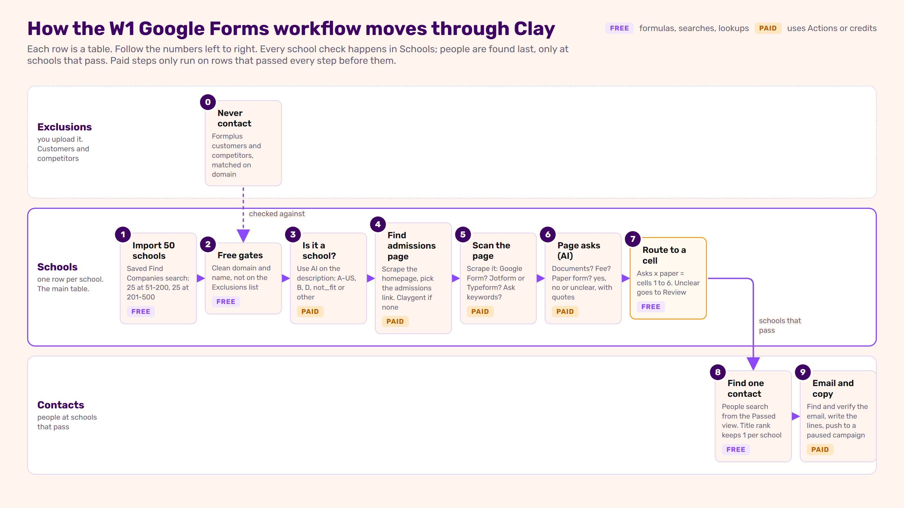

# Clay Build Guide: W1 Google Forms or paper forms (Formplus)

A step-by-step guide to building `output/campaigns/google-forms-documents-payments/workflow-spec.md` in Clay. Written for someone who has never built anything in Clay. Follow the parts in order. Each step tells you **why** it exists, **what to click**, **what to type**, **how to check it worked** and **what it costs**.

> **Don't skip the checks.** The most common Clay mistake is running a column on 50 rows before checking it worked on 1. Every paid step below is run on 1 row first (AI columns on 2 or 3 rows you can judge), and every step ends with a check. If the check fails, fix it before moving on.

---

## Contents

- [What you are building](#what-you-are-building)
- [Clay words you need](#clay-words-you-need)
- [Before you start](#before-you-start)
- [Part 0. Set up the workbook](#part-0-set-up-the-workbook)
- [Part 1. Exclusions table](#part-1-exclusions-table)
- [Part 2. Import the schools](#part-2-import-the-schools)
- [Part 3. Free gates on each school](#part-3-free-gates-on-each-school)
- [Part 4. Is it a school we want? (F1)](#part-4-is-it-a-school-we-want-f1)
- [Part 5. Find the admissions page](#part-5-find-the-admissions-page)
- [Part 6. Scan the admissions page](#part-6-scan-the-admissions-page)
- [Part 7. What does the page ask for? (Page asks)](#part-7-what-does-the-page-ask-for-page-asks)
- [Part 8. Route each school to a cell](#part-8-route-each-school-to-a-cell)
- [Part 9. Find people at schools that pass](#part-9-find-people-at-schools-that-pass)
- [Part 10. Pick one contact per school](#part-10-pick-one-contact-per-school)
- [Part 11. Find and verify the work email](#part-11-find-and-verify-the-work-email)
- [Part 12. Write the email lines](#part-12-write-the-email-lines)
- [Part 13. Views for the operator](#part-13-views-for-the-operator)
- [Part 14. Connect Instantly (build it, don't run it)](#part-14-connect-instantly)
- [What it costs](#what-it-costs)
- [Final checklist](#final-checklist)
- [When something goes wrong](#when-something-goes-wrong)
- [Spec decisions (2026-11-15)](#spec-decisions-2026-11-15)

---

## What you are building

The spec says: take US private, charter, independent and Catholic schools from Clay's company search, find each school's admissions or registration page, and keep only the schools whose page **runs a Google Form while asking families for documents or a fee**. Each school lands in one of 6 "cells" (what the page asks for x whether a paper form sits beside the Google Form). Then find one admissions contact per school, find their email, and write the approved Email 1 to 3 lines for that cell. Email is the only channel built this week: the spec's LinkedIn DMs are out of scope until a LinkedIn tool is chosen.

You will build **3 tables** inside **1 workbook**:



Each row of the picture is a table. The numbers are the order you build in. Step 0 is the list you upload first. In this guide, diagram step 8 is Parts 9 and 10, and diagram step 9 is Parts 11, 12 and 14.

Why this shape:
- **Account-first**, because the list starts from companies (spec section 1): Clay's company search finds the schools, and the trigger (a Google Form on the admissions page) is something about the school, not about a person.
- **Every school check happens once, in `Schools`.** The page scan and the AI reads cost money per row, so they run once per school, before anyone is searched for.
- **People are found last**, and only at schools that passed every check. No one pays for a person or an email at a school that won't be contacted.

What a finished row in **Schools** looks like, reading left to right (made-up values):

| School | Domain | Size | Segment | Admissions page | Google Form? | Asks docs | Asks fee | Paper form | Cell | Passes? |
|---|---|---|---|---|---|---|---|---|---|---|
| Example Day School | example.org | 51-200 | A-US | example.org/admissions | Yes | yes | no | yes | 2 | Yes |

And in **Contacts**: `Jane D. | Director of Admissions | example.org | Title rank 1 | Ready to Contact? Yes | jane@example.org | E1 L1 … E3 L1`.

---

## Clay words you need

| Word | What it means |
|---|---|
| **Workbook** | A folder of tables for one campaign. |
| **Table** | A spreadsheet. One row per school or per person. |
| **Source** | Where a table's rows come from (a Clay search, a CSV, another table). |
| **Column** | One piece of information per row. Three kinds matter: **plain** (you type or import it), **formula** (Clay calculates it, free), **enrichment / action** (Clay calls a data provider, a scraper or AI, usually costs). |
| **Formula** | A small calculation, like a spreadsheet formula. Free. Clay has an AI helper: describe what you want in plain English and it writes the formula for you. |
| **Enrichment** | A column that looks something up or fetches something (a web page, an email). Costs **Actions**, and sometimes **Data Credits**. |
| **Scrape Website** | An enrichment that fetches one web page and returns its text and links. This build uses it twice: on the homepage and on the admissions page. |
| **Use AI** | A column that sends text already in the row to an AI model with your prompt and returns an answer. Here it always returns **JSON** (named fields). |
| **Claygent** | Clay's web-browsing AI. It visits pages itself. Costs more than Use AI, so here it is only a fallback. |
| **JSON** | Answers in named fields, like `{"asks_documents": "yes", "documents_evidence": "…"}`. You can pull each field into its own column. |
| **Lookup** | A column that reads a matching row from another table in your workbook. Free. |
| **Run condition** ("Only run if") | A rule on a paid column: it only runs on rows where the rule is true. This is how you avoid paying for rows you'll throw away. |
| **Auto-run** | When on, new columns run on every row by themselves. **Keep it off** while building. |
| **Actions** | Clay's main usage meter. About 1 Action per enrichment per row. Unused Actions expire monthly. |
| **Data Credits** | A second meter, used when Clay pays a data provider for you (for example, email finders). |
| **View** | A saved filter on a table, like "only schools that passed". |
| **Cell** (spec word) | One of the spec's 6 routing boxes. It decides which version of each email line a school gets. |

---

## Before you start

Tick these off **before** you build. None of them should be done live.

- [ ] **Clay account** with access to the workspace. Note which plan it's on (Settings → Plans & billing). See [What it costs](#what-it-costs) for the most this test can spend.
- [ ] **The saved Find Companies search** is in the workspace: headquarters United States, industry "Primary and Secondary Education", the description filter from spec section 2, size bands `51-200` and `201-500` for this test.
- [ ] **Email finder connections** (Settings → Connections) for any providers you have your own keys for: Prospeo, Icypeas, Leadmagic, Findymail, and Bounceban for verification. Without your own keys, Clay uses its own and charges Data Credits.
- [ ] **Instantly connected** to Clay (Settings → Connections). Only needed for Part 14.
- [ ] **The spec is open** next to you. Sections 2 (who's in and out), 3 (sources), 4 (signals), 5 (cells) and 6 (variables) are what you're building. The Copy section is pasted into Part 12 for you.
- [ ] **The Exclusions CSV** is ready, with domains filled in (Part 1).
- [ ] **Test size: 50 schools**, 25 from the `51-200` band and 25 from the `201-500` band.

---

## Part 0. Set up the workbook

**Why:** one place for everything in this campaign, so anyone can find it and follow it.

1. In Clay, click **+ New** (top left) → **Workbook**.
2. Name it: `Formplus · W1 Google Forms (A-US schools)`.
3. In the workbook description, paste: *"Signal: US schools whose admissions or registration page runs a Google Form while asking for documents or a fee. Spec: formplus-gtm-os/output/campaigns/google-forms-documents-payments/workflow-spec.md. Test: 50 schools. Nothing sends until owner approval."*

**Check:** the workbook appears in your Clay home with that name.
**Cost:** free.

---

## Part 1. Exclusions table

**Why:** the spec (section 2, Exclude) says Formplus's own customers and its competitors are never contacted. They go in one table that `Schools` checks against. HubSpot checks (customers, open deals, suppressions, 90-day re-entry) come in Week 3; until then this table is the only customer check.

### 1.1 Make the CSV

The file is ready: `exclusions.csv` in this folder (kept local: `.gitignore` blocks CSVs). It has a 4th column, `Source URL`, showing where each domain was confirmed: the customer's own Formplus case study or user story (most list a "Website:"), or the competitor's own site as linked in `context/docs/research/competitors.md`. The names come from `context/docs/research/customers.md` and `context/positioning/competitors.md`:

| Company Name | Domain | Type |
|---|---|---|
| Polk State College Charter Schools | polk.edu | customer |
| Polk State Lakeland Collegiate |  | customer |
| Colorado Technology Student Association (COTSA) | coloradotsa.org | customer |
| Pennsylvania Academy of Ballet | paacademyofballet.com | customer |
| National Psychology Training Consortium (NPTC) | psychologyinterns.org | customer |
| University of Notre Dame |  | customer |
| AASHE | aashe.org | customer |
| Ruby's Place | rubysplace.org | customer |
| Motive School of Movement | motivemovement.org | customer |
| YMCA (Latin America and Caribbean) | lacaymca.org | customer |
| Yellow Dandelion Workshops | yellowdandelionworkshops.com | customer |
| Career Consultant | careerconsultants.co.uk | customer |
| Perpetual CPA | perpetualcpa.com | customer |
| Marine Mammal Protected Areas Task Force | marinemammalhabitat.org | customer |
| Performance Equipment | pequipment.com | customer |
| We Insure Group | weinsuregroup.com | customer |
| I Made It! Market | imadeitmarket.com | customer |
| Inspirock | inspirock.com | customer |
| Kellton Tech | kelltontech.com | customer |
| Total Sec Oy | totalsec.fi | customer |
| Beauty Bar Group | beautybargroup.com | customer |
| B.E Naturale Demo Staffing Agency | benaturalbrand.com | customer |
| Watamu Treehouse | treehouse.co.ke | customer |
| Google Forms | google.com | competitor |
| Jotform | jotform.com | competitor |
| Typeform | typeform.com | competitor |
| SurveyMonkey | surveymonkey.com | competitor |
| Microsoft Forms | microsoft.com | competitor |
| Tally | tally.so | competitor |
| KoboToolbox | kobotoolbox.org | competitor |
| ODK | getodk.org | competitor |
| SurveyCTO | surveycto.com | competitor |
| Wufoo |  | competitor |
| Formstack |  | competitor |

**Four domains are blank** because no source confirms them: University of Notre Dame and Polk State Lakeland Collegiate (logos only, no link), Wufoo and Formstack (no link to their own sites in the research). Fill them in by hand from each organisation's own website if you want them covered.

**Domain** is how `Schools` matches against this list. Type it plain: `example.org`. No `https://`, no `www.`, no slash at the end. Find each one on the organisation's own website (the address bar on its homepage), and check it's the organisation's main site, not a sub-page or a product site. **Don't guess a domain.** If you can't find one, leave it blank: a blank domain can't match anything, so it does no harm, but it also protects nothing, so note which ones are blank.

> **Why domain and not name:** names vary ("Polk State College Charter Schools" vs "Polk State Lakeland Collegiate") and clash with unrelated organisations. A domain belongs to one organisation.

> Only the school and education customers can realistically show up in this search. The others are listed so the same table works for the B (nonprofit) build.

### 1.2 Upload it

1. Inside the workbook, click **+ Add table** → **Import CSV**.
2. Upload `exclusions.csv`. Name the table `Exclusions`.

**Check:** 34 rows, and the Domain column has no `https://` or `www.` in it.
**Cost:** free.

---

## Part 2. Import the schools

**Why:** this is the company universe (spec section 3, step 1). Clay's company search filters by headquarters country, industry, size and description, all in one search. Searching and importing is **free**. The spec's preview counts (about 2K schools at `51-200`, 356 at `201-500`) tell you the full list is there; this test imports 25 from each.

### 2.1 Import 25 schools from the `51-200` band

1. In the workbook, click **+ Add table** → **Find companies**, and open your **saved search** (may be under "Saved searches" at the top of the filter panel; if you can't find it, set the filters again from spec section 2).
2. Check the filters match the spec:

| Filter | Set it to | Why |
|---|---|---|
| **Location** | United States, **headquarters only** (may be a "HQ only" tick box) | A school with any US office would pass without it |
| **Industry** | Primary and Secondary Education | Spec section 2, confirmed in Clay's picker 2026-11-15 |
| **Description contains any of** | private school · charter school · independent school · day school · academy · Catholic school · Montessori · admissions | Removes edtech companies, education nonprofits and state education departments |
| **Company size** | **51-200 only** for this import | The test splits the two bands evenly |

3. Look at the **total count** above the preview and write it down (spec preview: about 2K).
4. Set the import **limit to 25**. Click **Import** (or **Save to table**). Name the table `Schools`.
5. **Turn Auto-run OFF**: open the table's settings (the ⚙ or "…" menu at the top of the table) → **Auto-update / Auto-run** → off. Do this before adding any column.

### 2.2 Add 25 schools from the `201-500` band

1. In `Schools`, open the source panel (click the source column header, or **Sources** at the top of the table) → **+ Add source** → **Find companies**.
2. Same filters, but **Company size: 201-500 only**. Write down the count (spec preview: 356).
3. Limit **25**, and add the results **to this table**.

> If your Clay doesn't let you add a second search to the same table, import the `201-500` search into a temporary table, then in it add **+ Add column** → **Send table data** → destination `Schools`, map the same fields, and run it. Delete the temporary table afterwards.

### 2.3 Add the fields you need as columns

1. Click any cell in the source column. A panel opens showing everything the search returned for that school.
2. **Add as column** for: name, domain, size, industry, description, LinkedIn URL. Rename them `Company Name`, `Domain`, `Size`, `Industry`, `Description`, `LinkedIn URL`.
3. Change `Domain`'s type to **URL** (column header → Edit column → Data type).

### 2.4 Remove duplicates

Table settings → **Deduplicate** → choose `Domain`.

**Check:** 50 rows: 25 with Size `51-200`, 25 with `201-500`. Every row has a Domain and a Description. Open 3 domains in your browser: are they really US private, charter, independent or Catholic schools?
**Cost:** free.

---

## Part 3. Free gates on each school

**Why:** drop the rows we know are wrong **before** spending anything. Everything here is a formula or a lookup (free).

**How to add a formula column:** click **+ Add column** (right end of the table) → **Formula**. You can type the formula, or click **Use AI** inside the formula box and describe it in plain English. When the formula refers to another column, type `/` and pick the column from the list. Below, columns are written as `{{Column Name}}`. Paste the **Plain English** text into the column's description too, so anyone reading the table knows what it does.

### 3.1 Helper formulas

| Column | Plain English | Formula |
|---|---|---|
| `Domain Clean` | The domain in lowercase without https://, www. or a trailing slash | `({{Domain}} \|\| "").toLowerCase().replace(/^https?:\/\//, "").replace(/^www\./, "").replace(/\/.*$/, "")` |
| `School Name` | The company name without legal endings like Inc, LLC, Corp or Ltd | `({{Company Name}} \|\| "").replace(/,?\s+(inc\|llc\|corp\|corporation\|ltd)\.?$/i, "").trim()` |

**Check:** a domain shown as `https://www.example.org/` becomes `example.org`. "Example Academy, Inc." becomes "Example Academy".

> `School Name` is the spec's C2 (`{{school_name}}`). The spec's fallback is the page title; if a school's name is blank here, fix it by hand from the admissions page title in Part 6.

### 3.2 `Exclusion Match` (lookup, X2)

1. **+ Add column** → search for **Lookup single row in other table**.
2. Table: `Exclusions`. Match column in Exclusions: `Domain`. Value from this table: `{{Domain Clean}}`.
3. Save, then **run it on all rows** (lookups are free).

**Check:** temporarily add a row to `Exclusions` with the domain of one school in your table. Its `Exclusion Match` should fill in. Then delete the test row and re-run.

### 3.3 `Pass Free Gates?`

- Plain English: *"True if Domain Clean is not empty and Exclusion Match found nothing."*
- Formula:
```javascript
!!{{Domain Clean}} && !{{Exclusion Match}}
```

**Check:** sort by `Pass Free Gates?`. Every false row should have a blank domain or a match in `Exclusions`.
**Cost:** free.

---

## Part 4. Is it a school we want? (F1)

**Why:** spec signal F1. The search filters are good but not perfect: the spec's preview saw public high schools, a think tank and a camp provider slip through (mostly in the `11-50` band, which this test leaves out on purpose). This build is **K-12 schools only** (decided 2026-11-15), so arts schools, student associations and training consortia are `not_fit` too. Telling a private school from a public one or a camp is a judgement about **what the organisation is**, so it's an AI column, not a formula. It reads the description the search already returned, so it's the cheapest AI step.

### 4.1 `Segment (AI)`: Use AI

1. **+ Add column** → **Use AI**.
2. Prompt:
   > *You are checking whether an organisation is a US school that takes applications or registrations from families or students.*
   >
   > *Organisation: {{School Name}} ({{Domain Clean}}). LinkedIn industry: {{Industry}}. Size: {{Size}}. Description: {{Description}}*
   >
   > *1. segment, exactly one of:*
   > *"A-US": a US charter, private, independent or Catholic K-12 school (including Montessori and day schools).*
   > *"B": a nonprofit organisation that is not itself a school.*
   > *"D": a service business that takes bookings, orders or payments and is not a school.*
   > *"not_fit": a public or district school, a school district or state education department, a think tank, a camp provider, an arts school, a student association, a training consortium, an edtech or software company, or a healthcare organisation handling patient data.*
   > *"other": the description doesn't say enough to choose.*
   > *Don't guess from the name or industry label alone.*
   >
   > *2. not_fit_reason: if segment is not_fit, one short phrase saying why (for example "public district school"). Otherwise empty.*
   >
   > *3. segment_evidence: a word-for-word quote from the description that supports your answer. Empty if segment is other.*
3. Output format: **JSON**, with exactly these fields:
   - `segment`: text, must be one of `A-US`, `B`, `D`, `not_fit`, `other`
   - `not_fit_reason`: text
   - `segment_evidence`: text
4. **Run condition:** `{{Pass Free Gates?}} === true`
5. Run on **3 schools you can judge yourself**: one obvious private or Catholic school, one whose description is short or vague, and one that looks least like a school in your 50. Read each answer and its evidence against the school's website. If one is wrong, fix the prompt and re-run the same 3.
6. Then run on the rest.

### 4.2 Formulas the rest of the build uses

| Column | Plain English | Formula |
|---|---|---|
| `Segment` | The segment field from Segment (AI) | `{{Segment (AI)}}?.segment \|\| ""` |
| `Fit?` | True only if Segment is A-US | `{{Segment}} === "A-US"` |

> **What `other` means:** the school stops here and goes to the **Review** view (Part 13). A person reads the description and either sets it to A-US by hand or leaves it out. `B` rows wait for the B build; `D` and `not_fit` rows are out.

**Check:** filter `Fit? = false` and read each `segment_evidence`. Would you agree with every one?
**Cost:** about **1 Action plus a small AI cost per school** that passed the free gates.

---

## Part 5. Find the admissions page

**Why:** spec section 3, step 4. The trigger is a Google Form **on the admissions or registration page**, so first we find that page. A homepage scrape usually lists it in the menu. Claygent is the fallback for the schools where it doesn't.

### 5.1 `Homepage Scrape`

1. **+ Add column** → **Scrape Website** (if you can't find it, search the enrichment list for "scrape" and pick Clay's own website scraper).
2. Input URL: `"https://" + {{Domain Clean}}`
3. **Run condition:** `{{Fit?}} === true`
4. Run on **1 row**. Open the cell and write down what it returned: the field holding the **page text**, the field holding the **list of links**, and whether each link comes with its **link text** (the words you click on).
5. Then run on the rest.

**Cost:** about **1 Action per school** (an enrichment; watch the Actions counter on the first row to confirm).

### 5.2 `Admissions URL (found)`

- Plain English: *"From the Homepage Scrape links, return the first link whose URL or link text contains admission, admissions, apply, application, enrol, enroll, enrollment, registration or register. Empty if none."*
- The formula will look roughly like this. **The field names depend on what your Scrape Website cell shows, so let the AI helper write it from the real cell:**
```javascript
(({{Homepage Scrape}}?.links) || []).map(l => typeof l === "string" ? { url: l, text: "" } : l).find(l => /admission|apply|application|enrol|enroll|registration|register/i.test((l.url || l.href || "") + " " + (l.text || "")))?.url || ""
```

**Check:** open 3 rows. Is the URL really the admissions or registration page? Watch for "apply" matching job openings ("apply to work here"): if you see that, add `/careers|jobs|employment/i` as an exclusion in the plain English and let the helper rewrite it.

### 5.3 `Admissions URL (web)`: Claygent, only where 5.2 found nothing

1. **+ Add column** → **Claygent**.
2. Prompt:
   > *Visit {{Domain Clean}}. Find the page where families apply, enrol or register for {{School Name}} (the admissions, enrollment or registration page). Return its full URL. If the school has no such page, say so.*
3. Output format: **JSON**:
   - `admissions_page_url`: text (empty if none)
   - `found`: text, must be one of `yes`, `no`
   - `evidence`: text (the link text or page heading you used)
4. **Run condition:** `{{Fit?}} === true && !{{Admissions URL (found)}}`
5. Run on **1 row**, open the URL it returned and check it yourself, then the rest.

> A page Claygent finds must still match the admissions keywords in its URL or title (spec T2, decided 2026-11-15). `Admissions Page Match?` (6.3) checks that for every page, so a Claygent page called "Join our community" drops at T2.

### 5.4 `Admissions URL`

- Plain English: *"Admissions URL (found) if it has a value, otherwise the admissions_page_url from Admissions URL (web)."*
```javascript
{{Admissions URL (found)}} || {{Admissions URL (web)}}?.admissions_page_url || ""
```

> This column is the spec's `{{admissions_page_url}}`. It is for QA only: the copy never pastes the URL.

**Check:** every `Fit?` row has an Admissions URL, or Claygent said `found: no`. Schools with no admissions page stop here.
**Cost:** Scrape Website about 1 Action per school. Claygent costs more per row, but only runs where the homepage didn't show the page.

---

## Part 6. Scan the admissions page

**Why:** spec section 3, step 5, and signals T2, X1, C1 and P1. We fetch the admissions page once and run free formulas over it. Everything after the scrape in this part is free, except the Claygent backup in 6.4.

### 6.1 `Admissions Scrape`

1. **+ Add column** → **Scrape Website**. Input URL: `{{Admissions URL}}`
2. **Run condition:** `{{Fit?}} === true && !!{{Admissions URL}}`
3. Run on **1 row** whose admissions page you know embeds a Google Form (open a few pages in your browser first and pick one with a form on the page). **This is the spec's open check (UNVERIFIED): does the scrape return iframe `src` values?** Open the cell and look for `docs.google.com/forms` anywhere in it. Write down the answer:
   - **Yes**, it's there: the formula in 6.3 will catch embedded forms. You can skip 6.4.
   - **No**, the form is visible on the page but not in the cell: the scrape doesn't return iframes. Build 6.4 (Claygent backup).
4. Then run on the rest.

**Cost:** about **1 Action per school** with an admissions page.

### 6.2 Pull out what the formulas need

From the 1-row cell, **Add as column** (or write a formula the AI helper builds from the real cell):

| Column | What it holds |
|---|---|
| `Page Text` | The visible text of the page |
| `Page Links` | All links on the page, as one text: each link's URL and link text |
| `Page Iframes` | Any iframe `src` values (leave empty if the scrape has none) |
| `Page Title` | The page title (may be called `title` or `meta.title`) |

### 6.3 Free formulas on the page

| Column | Spec | Plain English | Formula |
|---|---|---|---|
| `Admissions Page Match?` | T2 | True if the Admissions URL or the page title contains admission, apply, application, enrol, enroll, enrollment, registration or register | `/admission\|admissions\|apply\|application\|enrol\|enroll\|enrollment\|registration\|register/i.test(({{Admissions URL}} \|\| "") + " " + ({{Page Title}} \|\| ""))` |
| `GForm Link Found?` | T2 | True if the links or iframes contain docs.google.com/forms or forms.gle | `/docs\.google\.com\/forms\|forms\.gle/i.test(({{Page Links}} \|\| "") + " " + ({{Page Iframes}} \|\| ""))` |
| `Paid Builder?` | X1 | True if the links or iframes contain jotform.com, typeform.com, formstack.com or wufoo.com | `/jotform\.com\|typeform\.com\|formstack\.com\|wufoo\.com/i.test(({{Page Links}} \|\| "") + " " + ({{Page Iframes}} \|\| ""))` |
| `Process Type` | C1 | admissions, enrollment, registration or camp from the URL and title, first match wins; other if none | `(t => /admission\|apply\|application/.test(t) ? "admissions" : /enrol/.test(t) ? "enrollment" : /regist/.test(t) ? "registration" : /camp/.test(t) ? "camp" : "other")((({{Admissions URL}} \|\| "") + " " + ({{Page Title}} \|\| "")).toLowerCase())` |
| `Ask Keywords?` | P1 | True if the page text or links contain any of the document, payment or paper keywords from the spec, or a dollar amount within 50 characters of "fee" | see below |

`Ask Keywords?` is long, so here it is in full:
```javascript
/upload|attach|transcript|birth certificate|report card|immunization|proof of residency|email your documents|send copies|application fee|registration fee|deposit|tuition deposit|proof of payment|pay by check|money order|print and|mail to|drop off|return to the office/i.test({{Page Text}} || "")
|| /\$\s?\d[\d,.]*.{0,50}fee|fee.{0,50}\$\s?\d/i.test({{Page Text}} || "")
|| /\.(pdf|docx?)(\?|"|'|\s|$)/i.test({{Page Links}} || "")
```

**Check:** pick 3 scanned pages and open them in your browser. Does `GForm Link Found?` match what you see? Does `Process Type` read right? Does `Ask Keywords?` say true on a page that mentions an application fee?

### 6.4 `GForm (web)`: Claygent backup for embedded forms

**Build this only if 6.1 showed the scrape misses iframes.**

1. **+ Add column** → **Claygent**.
2. Prompt:
   > *Visit {{Admissions URL}}. Does this page link to or embed a Google Form (an address containing docs.google.com/forms or forms.gle, including inside an embedded frame)? Look only at this page.*
3. Output format: **JSON**:
   - `google_form_found`: text, must be one of `yes`, `no`, `unclear`
   - `google_form_url`: text (empty if none)
   - `evidence`: text (where on the page you saw it)
4. **Run condition:** `{{Fit?}} === true && !!{{Admissions URL}} && {{GForm Link Found?}} !== true && {{Paid Builder?}} !== true`
5. Run on **2 rows**: one page you know embeds a Google Form and one you know doesn't. Both answers right? Then the rest.

> `unclear` counts as no Google Form. The school drops at T2 rather than being emailed about a form we couldn't see.

### 6.5 `Google Form on Page?` (T2)

- Plain English: *"True if the page matches the admissions keywords, and either GForm Link Found is true or GForm (web) says yes."*
```javascript
{{Admissions Page Match?}} === true && ({{GForm Link Found?}} === true || {{GForm (web)}}?.google_form_found === "yes")
```

**Check:** filter `Google Form on Page? = true`. Open every page in your browser and confirm a Google Form is there.
**Cost:** free, except 6.4 (Claygent, more per row than Use AI, only on pages without a Google Form link).

---

## Part 7. What does the page ask for? (Page asks)

**Why:** spec signal PA, which feeds the routers R1, R2 and R3. Keywords can't tell "upload your photo to the gallery" from a document request, or "no fee" from a fee, so an AI reads the page and must quote its evidence. The free keyword check (`Ask Keywords?`) runs first, so AI only reads pages that mention at least one keyword.

### 7.1 `Page Asks (AI)`: Use AI

1. **+ Add column** → **Use AI**.
2. Prompt:
   > *You are reading a school's admissions or registration page. Answer only from the text and links below. Don't guess.*
   >
   > *Page: {{Admissions URL}}. Title: {{Page Title}}*
   > *Links: {{Page Links}}*
   > *Text: {{Page Text}}*
   >
   > *1. asks_documents: "yes" if the page asks families or applicants to provide documents (for example transcripts, a birth certificate, report cards, immunization records, proof of residency), by upload, attachment, email or post. "no" if it clearly doesn't. "unclear" if you can't tell.*
   > *2. asks_payment: "yes" if the page asks for a fee or payment as part of applying or registering (for example an application fee, registration fee or deposit, by any method). "no" if it clearly doesn't, or says there is no fee. "unclear" if you can't tell.*
   > *3. has_paper_form: "yes" if the page offers a printable, PDF or Word application or registration form, or asks people to print, mail or drop off a form. "no" if it clearly doesn't. "unclear" if you can't tell.*
   > *4. documents_evidence, payment_evidence, paper_evidence: for each "yes", copy the exact words from the page that show it, word for word. Otherwise empty.*
3. Output format: **JSON**, with exactly these fields:
   - `asks_documents`: text, must be one of `yes`, `no`, `unclear`
   - `asks_payment`: text, must be one of `yes`, `no`, `unclear`
   - `has_paper_form`: text, must be one of `yes`, `no`, `unclear`
   - `documents_evidence`: text
   - `payment_evidence`: text
   - `paper_evidence`: text
4. **Run condition:** `{{Google Form on Page?}} === true && {{Ask Keywords?}} === true && {{Fit?}} === true && {{Paid Builder?}} !== true && !{{Exclusion Match}}`
5. Run on **3 pages you can judge yourself**: one that asks for documents, one that asks for a fee, and one with a printable PDF form. Open each page, find each evidence quote on it (Ctrl+F), and check every yes/no. If one is wrong, fix the prompt and re-run the same 3.
6. Then run on the rest.

**Cost:** about **1 Action plus a small AI cost per page** that reached this step.

### 7.2 The router formulas

| Column | Spec | Plain English | Formula |
|---|---|---|---|
| `R1 Documents?` | R1 | True only if asks_documents is yes | `{{Page Asks (AI)}}?.asks_documents === "yes"` |
| `R2 Payment?` | R2 | True only if asks_payment is yes | `{{Page Asks (AI)}}?.asks_payment === "yes"` |
| `R3 Paper?` | R3 | True only if has_paper_form is yes | `{{Page Asks (AI)}}?.has_paper_form === "yes"` |
| `Neither Asked?` | T3 | True if asks_documents and asks_payment are both no | `{{Page Asks (AI)}}?.asks_documents === "no" && {{Page Asks (AI)}}?.asks_payment === "no"` |
| `Needs Review?` | T3 | True if the AI ran, the row isn't a clear no on both, and any of the three answers is unclear | `!!{{Page Asks (AI)}} && !{{Neither Asked?}} && ["asks_documents", "asks_payment", "has_paper_form"].some(k => {{Page Asks (AI)}}?.[k] === "unclear")` |
| `Asks Docs or Payment?` | T3 | True if R1 Documents or R2 Payment is true | `{{R1 Documents?}} === true \|\| {{R2 Payment?}} === true` |

> **What `unclear` means:** only `yes` counts. A school with any `unclear` answer goes to the **Review** view and is never routed or contacted until a person opens the page and types the right answer into the cell. A school where both documents and payment are `no` drops out (spec T3).

**Check:** filter `Needs Review? = true` and open one page. Could you have answered? If most rows land here, the page text is probably missing (go back to 6.2).

---

## Part 8. Route each school to a cell

**Why:** spec section 5. The 6 cells are what the page asks for (documents only, payment only, both) x paper alongside (yes, no). The cell picks the email lines.

### 8.1 Routing formulas

| Column | Plain English | Formula |
|---|---|---|
| `Ask Group` | documents if only R1 Documents is true, payment if only R2 Payment is true, both if both are true, empty if neither | `{{R1 Documents?}} && {{R2 Payment?}} ? "both" : {{R1 Documents?}} ? "documents" : {{R2 Payment?}} ? "payment" : ""` |
| `Proof Customer` | COTSA for cells 1 and 5, Polk State for cells 2 and 6, PAB for cells 3 and 4 | `({1: "COTSA", 5: "COTSA", 2: "Polk State", 6: "Polk State", 3: "PAB", 4: "PAB"})[Number({{Route Cell}})] \|\| ""` |
| `Proof Support` | Ruby's Place for cells 3 and 4, empty otherwise | `[3, 4].includes(Number({{Route Cell}})) ? "Ruby's Place" : ""` |

#### `Route Cell`: the spec's cells 1 to 6 (routes on Ask Group and R3 Paper?)

- **Plain English:** *"Empty if Asks Docs or Payment is false or Needs Review is true. Otherwise: documents only gives 1 without paper and 2 with paper; payment only gives 3 without paper and 4 with paper; both gives 5 without paper and 6 with paper."*
- **Formula:**
```javascript
(!{{Asks Docs or Payment?}} || {{Needs Review?}}) ? "" :
({"documents": [1, 2], "payment": [3, 4], "both": [5, 6]})[{{Ask Group}}][{{R3 Paper?}} ? 1 : 0]
```
- **Check:** a page asking for documents with a PDF form shows 2. A page asking for a fee only, no PDF, shows 3.

> `Route Cell` is the spec's `{{route_cell}}`, a routing key only. It never appears in copy. Build `Route Cell` before `Proof Customer` and `Proof Support`, which read it.

### 8.2 `School Passes?`

Every school-level check from the spec in one column. Only these schools get people searched.

- Plain English: *"True if all of these are true: Pass Free Gates, Fit, Google Form on Page, Asks Docs or Payment, Needs Review is false, Paid Builder is false, and Route Cell has a value."*
```javascript
{{Pass Free Gates?}} === true && {{Fit?}} === true && {{Google Form on Page?}} === true && {{Asks Docs or Payment?}} === true && {{Needs Review?}} !== true && {{Paid Builder?}} !== true && !!{{Route Cell}}
```

### 8.3 `Passed` view

View dropdown at the top of the table → **+ New view** → name it `Passed: find people` → filter `School Passes?` = true. Part 9 searches from this view.

**Check:** count the rows in the view and write the number down, with how many are in each cell (1 to 6). This is the spec's "cell spread". Open 3 passing schools and read the page: does the cell match what the page shows?
**Cost:** free.

---

## Part 9. Find people at schools that pass

**Why:** spec section 3, step 7, and section 2 Recipient. People come last, and only at schools in the `Passed` view. Clay's people search is **free**.

### 9.1 Search from the view

1. **+ Add table** → **Find people**. At the top of the filters, choose to find people **at companies from a table** (may be called "Companies from table" or "Search companies in a table"). Pick table `Schools`, view `Passed: find people`.
   > **Why a view and not pasted domains:** the search stays tied to the view, so it always searches exactly the schools that passed. Pasted domains are a snapshot and miss schools that pass later.
2. **Job title: include**: Admissions · Admission · Enrollment · Enrolment · Registrar · Instructional Technologist · Instructional Technology · Head of School · Principal
   **Job title: exclude**: Assistant (spec G1: titles containing "assistant" don't count, so there's no point importing them)
3. Import. Name the table `Contacts`. **Turn Auto-run OFF.**
4. From a source cell, **Add as column**: first name, last name, full name, job title, LinkedIn profile URL, and the **company domain** (inside the matched job → company → domain). Rename the domain column `Company Domain` and set its type to **URL**. Add a formula `Company Domain Clean` with the same formula as `Domain Clean` in Part 3.1, pointed at `{{Company Domain}}`.
5. Table settings → **Deduplicate** → `LinkedIn Profile`.

**Check:** compare the number of different domains in `Contacts` with the number of rows in the `Passed` view. One domain can match several companies in Clay's database, so you may see people from a same-named organisation elsewhere: Part 10's lookup drops anyone whose domain doesn't come back from `Schools`.

### 9.2 Apollo fallback (only for schools where Clay found no one)

1. In `Schools`: **+ Add column** → **Lookup multiple rows in other table** → table `Contacts`, match `Company Domain Clean` = `{{Domain Clean}}`. Name it `Contacts Found`.
2. Formula `Contacts Count`: `({{Contacts Found}}?.length || 0)`
3. **+ Add column** → Apollo's people search by company domain (search the enrichment list for "Apollo"; it may be called "Find people at company (Apollo)"). Input: `{{Domain Clean}}`, titles as in 9.1.
4. **Run condition:** `{{School Passes?}} === true && {{Contacts Count}} === 0`
5. Run on **1 row**. If it found someone, add them to `Contacts` with **Send table data** (destination `Contacts`, map name, title, LinkedIn profile and `Company Domain`), or type the row in by hand for a 50-school test.

**Cost:** the Clay search is free. The Apollo fallback is paid (about 1 Action per school it runs on), and only runs where Clay found nobody.

---

## Part 10. Pick one contact per school

**Why:** spec section 2 says one contact per school in v1, champion first. Signal G1 ranks titles; the lowest rank per school wins.

### 10.1 `Title Rank` (G1, in Contacts)

- Plain English: *"Empty if the title contains assistant. Otherwise 1 for admissions or enrollment titles, 2 for registrar, 3 for instructional technologist or instructional technology, 4 for head of school or principal, empty for anything else."*
```javascript
(t => /assistant/.test(t) ? "" : /admission|enrol/.test(t) ? 1 : /registrar/.test(t) ? 2 : /instructional technolog/.test(t) ? 3 : /head of school|principal/.test(t) ? 4 : "")(({{Job Title}} || "").toLowerCase())
```

**Check:** "Director of Admissions" → 1, "Registrar" → 2, "Head of School" → 4, "Math Teacher" → empty, "Assistant Principal" → empty, "Admissions Assistant" → empty.

> The order (admissions and enrollment first, then registrar, instructional technologist, head of school) is INFERRED in the spec. Titles containing "assistant" (Assistant Principal, Admissions Assistant) get no rank, as decided 2026-11-15.

### 10.2 `Top Contact LinkedIn` (in Schools)

1. In `Schools`, **re-run** `Contacts Found` (9.2) now that `Title Rank` exists.
2. Formula `Top Contact LinkedIn`. Plain English: *"From Contacts Found, keep the people with a Title Rank, sort by Title Rank (lowest first; keep the first found on a tie) and return the LinkedIn Profile of the first one."* Let the AI helper write it from the real `Contacts Found` cell. It will look roughly like:
```javascript
(({{Contacts Found}}) || []).filter(c => c["Title Rank"]).sort((a, b) => a["Title Rank"] - b["Title Rank"])[0]?.["LinkedIn Profile"] || ""
```

### 10.3 Bring the school facts back to each contact

In `Contacts`:

1. **+ Add column** → **Lookup single row in other table** → table `Schools`, match `Domain Clean` = `{{Company Domain Clean}}`. Name it `School Facts`.
2. From one cell, **Add as column**: `School Passes?`, `School Name`, `Route Cell`, `Ask Group`, `Proof Customer`, `Proof Support`, `Process Type`, `Admissions URL`, `Top Contact LinkedIn`.

> Only formula columns travel cleanly across a lookup, which is why every routing value in `Schools` is a formula.

### 10.4 `Ready to Contact?` (G2)

- Plain English: *"True if School Passes is true, Title Rank has a value, and this contact's LinkedIn Profile equals the school's Top Contact LinkedIn."*
```javascript
{{School Passes?}} === true && !!{{Title Rank}} && {{LinkedIn Profile}} === {{Top Contact LinkedIn}}
```

**Check:** filter `Ready to Contact? = true`. There should be **at most one row per school**. Open every row: would you be happy for this person to get the email?
**Cost:** free.

---

## Part 11. Find and verify the work email

**Why:** spec section 3, step 8. We only look up emails for people we will contact. This is usually the most expensive step.

1. In `Contacts`: **+ Add column** → **Find work email** (Clay's email **waterfall**: it tries several providers in order until one finds an email).
2. Inputs: full name `{{Full Name}}`, company domain `{{Company Domain Clean}}`, LinkedIn `{{LinkedIn Profile}}`.
3. Providers, in this order (spec section 3): **Prospeo, Icypeas, Leadmagic, Findymail**. Put any you've connected with your own key first.
4. Verification: **Bounceban** (or turn on the waterfall's built-in validation if Bounceban isn't offered). Choose the strict setting: **don't accept "catch-all" or "risky"**.
5. **Run condition:** `{{Ready to Contact?}} === true`
6. Run on **1 row**. Read the result: an email, plus a status such as "valid".
7. Then run on the rest of the `Ready to Contact?` rows.
8. From the waterfall, **Add as column**: `Work Email` (type Email) and `Email Status`.
9. Formula `Email Domain OK?`: *"True if the part of Work Email after the @ equals Company Domain Clean."* `(({{Work Email}} || "").split("@")[1] || "").toLowerCase() === {{Company Domain Clean}}`

**Check:** every row with an email has status valid. Rows where `Email Domain OK?` is false go to a review view (Part 13), not the sequencer. Email is the only channel this week, so rows with no valid email are dropped (spec section 7).
**Cost:** Actions plus Data Credits **for each provider step that actually runs**. A row found by the first provider costs less than one that goes through all four.

---

## Part 12. Write the email lines

**Why:** spec section 6 and the Copy section. Every version of every line is already written and approved (COPY-APPROVED 2026-11-13), so **these are formulas, not AI**: free, and identical every time.

Add these columns in `Contacts`. Every line starts with `!{{Ready to Contact?}} ? "" :`, so rows that won't be contacted stay blank. The wording inside the quotes is copied **exactly** from the spec's Copy section. Don't edit it here: change the spec first, then the formula.

For each line, paste the **Plain English** into the formula's **Use AI** helper and keep it as the column description, then compare what Clay wrote with the formula below. If they differ, use the one below: its wording was generated straight from the spec.

### 12.1 Helper

| Column | Plain English | Formula |
|---|---|---|
| `First Name Clean` | First name with only the first letter capitalised, empty if blank | `(n => n ? n.charAt(0).toUpperCase() + n.slice(1).toLowerCase() : "")(({{First Name}} \|\| "").trim())` |

> Check `First Name Clean` on names like "McKenzie" or "Mary-Jo": if it reads wrong, type the right name into `First Name` for that row rather than changing the formula.

### 12.2 Email 1

#### `E1 L1`: the opener (routes on Route Cell)

- **Plain English:** *"If Ready to Contact is false, leave blank. Otherwise write the approved Email 1 line 1 for this row's Route Cell (1 to 6), with School Name filled in."*
- **Approved wording** (spec, Email 1 Line 1):

   - CELL 1 (R1 true, R2 false, R3 false): From what I could find, {{school_name}}'s application runs on a Google Form and asks families for supporting documents.
   - CELL 2 (R1 true, R2 false, R3 true): Going by {{school_name}}'s website, families can apply two ways, a Google Form or a printable PDF, with supporting documents on top.
   - CELL 3 (R1 false, R2 true, R3 false): {{school_name}}'s website uses a Google Form for sign-ups and mentions a fee.
   - CELL 4 (R1 false, R2 true, R3 true): On {{school_name}}'s website there's a Google Form and a printable form to sign up, plus a fee to pay.
   - CELL 5 (R1 true, R2 true, R3 false): From my research, {{school_name}}'s application runs on a Google Form and also asks for documents and a fee.
   - CELL 6 (R1 true, R2 true, R3 true): Reading through {{school_name}}'s website, the full packet is there: a Google Form, a printable application, supporting documents and a fee.

- **Formula:**
```javascript
!{{Ready to Contact?}} ? "" :
({
  1: "From what I could find, " + {{School Name}} + "'s application runs on a Google Form and asks families for supporting documents.",
  2: "Going by " + {{School Name}} + "'s website, families can apply two ways, a Google Form or a printable PDF, with supporting documents on top.",
  3: {{School Name}} + "'s website uses a Google Form for sign-ups and mentions a fee.",
  4: "On " + {{School Name}} + "'s website there's a Google Form and a printable form to sign up, plus a fee to pay.",
  5: "From my research, " + {{School Name}} + "'s application runs on a Google Form and also asks for documents and a fee.",
  6: "Reading through " + {{School Name}} + "'s website, the full packet is there: a Google Form, a printable application, supporting documents and a fee."
})[Number({{Route Cell}})] || ""
```
- **Check:** one row from each cell present in your table. The school name reads naturally before "'s".

#### `E1 L2`: the situation (routes on Ask Group)

- **Plain English:** *"If Ready to Contact is false, leave blank. Otherwise write the approved Email 1 line 2 for documents only, payment only, or documents and payment."*
- **Approved wording:**

   - DOCUMENTS ONLY (cells 1, 2): Google Forms asks people to sign in to a Google account before they can upload a file, so I'd guess some documents still arrive by email.
   - PAYMENT ONLY (cells 3, 4): My guess is someone then matches each payment back to the right family by hand.
   - DOCUMENTS AND PAYMENT (cells 5, 6): Google Forms asks people to sign in to a Google account before they can upload a file, so my guess is the documents and the fee each arrive on their own.

- **Formula:**
```javascript
!{{Ready to Contact?}} ? "" :
({
  "documents": "Google Forms asks people to sign in to a Google account before they can upload a file, so I'd guess some documents still arrive by email.",
  "payment": "My guess is someone then matches each payment back to the right family by hand.",
  "both": "Google Forms asks people to sign in to a Google account before they can upload a file, so my guess is the documents and the fee each arrive on their own."
})[{{Ask Group}}] || ""
```

#### `E1 L3`: the value prop (routes on Ask Group; A live)

- **Plain English:** *"If Ready to Contact is false, leave blank. Otherwise write value-prop variant A for documents only, payment only, or documents and payment."*
- **Approved wording** (A is live; B is held as a test variant, column `E1 L3 B` below):

   - DOCUMENTS ONLY (cells 1, 2): A: Formplus is an online form builder that takes the application and the documents together in one form. B: Formplus lets schools take applications and documents together in one online form.
   - PAYMENT ONLY (cells 3, 4): A: Formplus is an online form builder that takes the registration and the fee together in one form. B: Formplus lets schools take registrations and fees together in one online form.
   - DOCUMENTS AND PAYMENT (cells 5, 6): A: Formplus is an online form builder that takes the application, the documents and the fee in one form. B: Formplus lets schools take applications, documents and fees in one online form.

- **Formula (`E1 L3`, variant A):**
```javascript
!{{Ready to Contact?}} ? "" :
({
  "documents": "Formplus is an online form builder that takes the application and the documents together in one form.",
  "payment": "Formplus is an online form builder that takes the registration and the fee together in one form.",
  "both": "Formplus is an online form builder that takes the application, the documents and the fee in one form."
})[{{Ask Group}}] || ""
```
- **Formula (`E1 L3 B`, variant B, test only):**
```javascript
!{{Ready to Contact?}} ? "" :
({
  "documents": "Formplus lets schools take applications and documents together in one online form.",
  "payment": "Formplus lets schools take registrations and fees together in one online form.",
  "both": "Formplus lets schools take applications, documents and fees in one online form."
})[{{Ask Group}}] || ""
```

#### `Social Proof`: the proof line (routes on Proof Customer)

- **Plain English:** *"If Ready to Contact is false, leave blank. Otherwise write the approved proof line for COTSA, Polk State or PAB."*
- **Approved wording:**

   - COTSA (cells 1, 5): The Colorado Technology Student Association (COTSA) moved its entries off Google Forms and says Formplus "made collection of URLs and forms WAY easier".
   - POLK STATE (cells 2, 6): Polk State College Charter Schools used to type paper applications into a spreadsheet and now gets enrollment applications "100% faster".
   - PAB (cells 3, 4): Pennsylvania Academy of Ballet has students register and pay online through PayPal, and was "up and running with Formplus in a matter of just a day or two."

- **Formula:**
```javascript
!{{Ready to Contact?}} ? "" :
({
  "COTSA": "The Colorado Technology Student Association (COTSA) moved its entries off Google Forms and says Formplus \"made collection of URLs and forms WAY easier\".",
  "Polk State": "Polk State College Charter Schools used to type paper applications into a spreadsheet and now gets enrollment applications \"100% faster\".",
  "PAB": "Pennsylvania Academy of Ballet has students register and pay online through PayPal, and was \"up and running with Formplus in a matter of just a day or two.\""
})[{{Proof Customer}}] || ""
```

### 12.3 Email 2

#### `E2 L1` (routes on Ask Group)

- **Plain English:** *"If Ready to Contact is false, leave blank. Otherwise write the approved Email 2 line 1 for documents only, payment only, or documents and payment."*
- **Approved wording:**

   - DOCUMENTS ONLY (cells 1, 2): To add to my last note, uploaded files go to the school's own Google Drive, Dropbox or OneDrive.
   - PAYMENT ONLY (cells 3, 4): To add to my last note, payments go straight to the school, not to Formplus, and Formplus doesn't add a fee on top of the payment provider.
   - DOCUMENTS AND PAYMENT (cells 5, 6): To add to my last note, uploaded files go to the school's own Google Drive, Dropbox or OneDrive, and payments go straight to the school, not to Formplus.

- **Formula:**
```javascript
!{{Ready to Contact?}} ? "" :
({
  "documents": "To add to my last note, uploaded files go to the school's own Google Drive, Dropbox or OneDrive.",
  "payment": "To add to my last note, payments go straight to the school, not to Formplus, and Formplus doesn't add a fee on top of the payment provider.",
  "both": "To add to my last note, uploaded files go to the school's own Google Drive, Dropbox or OneDrive, and payments go straight to the school, not to Formplus."
})[{{Ask Group}}] || ""
```

#### `E2 L2` (only for Proof Support = Ruby's Place, cells 3 and 4)

- **Plain English:** *"If Ready to Contact is false or Proof Support is not Ruby's Place, leave blank. Otherwise write the Ruby's Place line followed by a blank line."*
- **Approved wording:**

   - RUBY'S PLACE (cells 3, 4): Ruby's Place switched to Formplus when its Google Forms payment add-on was discontinued.
   - Cells 1, 2, 5, 6: line omitted.

- **Formula:**
```javascript
!{{Ready to Contact?}} ? "" :
{{Proof Support}} === "Ruby's Place" ? "Ruby's Place switched to Formplus when its Google Forms payment add-on was discontinued." + "\n\n" : ""
```

> The line ends with two line breaks so that, in Instantly, `{{e2l2}}` sits directly above "The form can also sit on your own website." with no blank line of its own. In cells 1, 2, 5 and 6 it's empty and the line disappears, as the spec says (Part 14).

### 12.4 Email 3

#### `E3 L1` (routes on Proof Support, otherwise Proof Customer)

- **Plain English:** *"If Ready to Contact is false, leave blank. Otherwise use Proof Support if it has a value, else Proof Customer, and write the approved Email 3 line 1 for it: the Ruby's Place line for Ruby's Place (cells 3 and 4), the COTSA line for COTSA, the Polk State line for Polk State."*
- **Approved wording:**

   - COTSA (cells 1, 5): One last example: COTSA now takes entries from "more than 2,000 participants" and calls the process "all digital".
   - POLK STATE (cells 2, 6): One last note: Polk State College Charter Schools says Formplus "decreased our time and cost ten times over".
   - RUBY'S PLACE (cells 3, 4): Last thing from me: Ruby's Place's COO said of Formplus, "It was the easiest to use, it provided what we needed and actually simplified the process for us".

- **Formula:**
```javascript
!{{Ready to Contact?}} ? "" :
({
  "COTSA": "One last example: COTSA now takes entries from \"more than 2,000 participants\" and calls the process \"all digital\".",
  "Polk State": "One last note: Polk State College Charter Schools says Formplus \"decreased our time and cost ten times over\".",
  "Ruby's Place": "Last thing from me: Ruby's Place's COO said of Formplus, \"It was the easiest to use, it provided what we needed and actually simplified the process for us\"."
})[{{Proof Support}} || {{Proof Customer}}] || ""
```

### 12.5 LinkedIn DM 1: not built this week

Email is the only channel built in 2026-W47 (spec section 7). LinkedIn DM 1 and DM 2 stay in the spec, but no LinkedIn tool is in the stack, so there is no `LI DM1` column yet. When a tool is chosen, add it like the email lines: a formula on `Ask Group`, guarded by `Ready to Contact?` and a LinkedIn Profile, with the wording copied from the spec.

### 12.6 Read the whole emails

Pick one row from each cell you have (up to 6). For each, paste Email 1 in order into a document: `First Name Clean`, then E1 L1, E1 L2, E1 L3, Social Proof, then the CTA and sign-off from the spec. Do the same for Email 2 and Email 3. Read each one out loud. If a line sounds wrong for that school, find which column produced it and fix that column (or the spec).

> **Spintax stays in Instantly, not in Clay.** The subject, CTAs and sign-offs have options like `{Thanks,|Best,|Cheers,}`. Put those directly in the Instantly templates. Sequencers don't process spintax that arrives inside a Clay variable.

**Check:** no line is blank on a `Ready to Contact?` row, except `E2 L2` outside cells 3 and 4. No row has a line from the wrong cell (compare `Route Cell` with E1 L1).
**Cost:** free.

---

## Part 13. Views for the operator

**Why:** someone opening these tables later should see what matters without understanding every column.

In `Schools`:

| View | Filter | Who uses it |
|---|---|---|
| `Passed: find people` | `School Passes?` = true | Part 9's search (already built) |
| `Review` | `Segment` = other, OR `Needs Review?` = true, OR `GForm (web)` google_form_found = unclear | A person checks these by hand |
| `Dropped` | `Pass Free Gates?` = false, OR `Fit?` = false (except other), OR `Google Form on Page?` = false, OR `Neither Asked?` = true, OR `Paid Builder?` = true | Spot-checking the gates |

In `Contacts`:

| View | Filter | Who uses it |
|---|---|---|
| `Ready to send` | `Ready to Contact?` = true AND `Email Status` = valid AND `Email Domain OK?` = true | The person loading Instantly |
| `Email review` | `Ready to Contact?` = true AND `Email Domain OK?` = false | A person checks the email by hand |

In `Ready to send`, hide helper formulas and keep: name, title, school, Route Cell, email, and the line columns. **Don't hide paid columns or lookups**: they show where the data came from.

---

## Part 14. Connect Instantly

**Build this column, but don't run it.** The spec's launch gate (section 7) is `campaign-qa` passed plus owner approval before any send.

1. In Instantly, create a campaign called `Formplus · W1 Google Forms · A-US`, and **leave it paused**. Build the three emails from the spec's Copy section, with the spintax exactly as written:
   - **Email 1**, subject `{google form question|your school's forms|a form question}`: `{{first_name}},` then `{{e1l1}}`, `{{e1l2}}`, `{{e1l3}}`, `{{social_proof}}` on their own lines with a blank line between each, then the CTA and sign-off from the spec.
   - **Email 2**, day 3 to 4, same thread: `{{first_name}},`, `{{e2l1}}`, a blank line, then `{{e2l2}}The form can also sit on your own website.` on one line (the formula adds the line breaks), then the CTA and `{{sender_name}}`.
   - **Email 3**, day 7 to 10, same thread: `{{first_name}},`, `{{e3l1}}`, then the CTA, which uses `{{school_name}}`, and `{{sender_name}}`.
   - `{{sender_name}}`, `{{sender_title}}` and `{{sender_company}}` come from the Instantly sender profile, not from Clay.
2. In `Contacts`: **+ Add column** → Instantly's **Add lead to campaign** action.
3. Map: email `{{Work Email}}`, first name `{{First Name Clean}}`, and custom variables `school_name` → `{{School Name}}`, `e1l1` → `{{E1 L1}}`, `e1l2` → `{{E1 L2}}`, `e1l3` → `{{E1 L3}}`, `social_proof` → `{{Social Proof}}`, `e2l1` → `{{E2 L1}}`, `e2l2` → `{{E2 L2}}`, `e3l1` → `{{E3 L1}}`.
4. **Run condition:** `{{Ready to Contact?}} === true && {{Email Status}} === "valid" && {{Email Domain OK?}} === true`
5. **Stop.** On launch day, after approval, run it on 1 row, check the lead and every variable appear correctly in the paused campaign, then run the rest.

LinkedIn is out of scope this week, so nothing is pushed to a LinkedIn tool.

**Cost:** about **1 Action per lead pushed**. The emails themselves cost nothing in Clay.

---

## What it costs

Free: the searches, imports, formulas, lookups, Send table data, views and the copy lines.

Paid, and only on rows that passed every check before it:

| Step | Runs on | Rough cost |
|---|---|---|
| Segment (AI) (4.1) | Schools that passed the free gates | about 1 Action + a small AI cost per school |
| Homepage Scrape (5.1) | `Fit?` schools | about 1 Action per school |
| Admissions URL (web), Claygent (5.3) | `Fit?` schools where the homepage showed no admissions link | more per school than Use AI (it browses) |
| Admissions Scrape (6.1) | `Fit?` schools with an admissions page | about 1 Action per school |
| GForm (web), Claygent (6.4) | Only if the scrape misses iframes; pages with no Google Form link | more per school than Use AI |
| Page Asks (AI) (7.1) | Pages with a Google Form and at least one ask keyword | about 1 Action + a small AI cost per page |
| Apollo fallback (9.2) | Passing schools where Clay found no one | about 1 Action per school |
| Email waterfall (11) | `Ready to Contact?` rows only (at most 1 per passing school) | Actions + Data Credits per provider step that runs |
| Instantly push (14) | Valid emails only, on launch day | about 1 Action per lead (0 in this test: built, not run) |

**The ceiling for the 50-school test.** Each school can reach at most 6 paid school-level columns (Segment, Homepage Scrape, Claygent page finder, Admissions Scrape, Claygent form backup, Page Asks), so at most **300 paid runs**, and the two Claygent columns only run on the rows the cheaper step missed. Contacts add at most one email waterfall per passing school (up to 4 provider steps plus verification). In practice every step drops schools, so the real number is much lower. How many drop at each step is **unknown until this test runs**: measuring it is part of the spec's sample (section 7).

Write the real numbers down as you go. Watch the Actions counter (top of Clay) before and after each paid step:

| Step | Rows it ran on | Actions before | Actions after | Data Credits |
|---|---|---|---|---|
| Segment (AI) | | | | |
| Homepage Scrape | | | | |
| Admissions URL (web) | | | | |
| Admissions Scrape | | | | |
| GForm (web) | | | | |
| Page Asks (AI) | | | | |
| Apollo fallback | | | | |
| Email waterfall | | | | |

---

## Final checklist

- [ ] Auto-run is **off** on every table.
- [ ] Every paid column has a **run condition**.
- [ ] Every paid column was tested on **1 row** (AI columns on 2 or 3 rows you judged) and the cell was read before running more.
- [ ] `Schools` has no duplicate domains; `Contacts` has no duplicate LinkedIn profiles.
- [ ] No school from `Exclusions` appears in `Passed: find people`.
- [ ] The iframe question (6.1) is answered and written in the work log, and the spec's UNVERIFIED mark can be updated.
- [ ] Every `Review` school is either fixed by hand or left out on purpose.
- [ ] At most one `Ready to Contact?` row per school.
- [ ] One email per cell present was read out loud and makes sense.
- [ ] Instantly campaign exists, **paused**; push column built and **not run**.
- [ ] Counts written down: search previews, rows passing each step, the cell spread, Actions spent per step.

---

## When something goes wrong

| What you see | Likely cause | Fix |
|---|---|---|
| Search shows far more or fewer schools than the spec's preview | A filter didn't apply (often HQ-only or the description filter) | Re-check each filter against Part 2.1 before importing |
| Import has 50 rows but all in one size band | Both bands were in the first search | Delete the rows, re-import with one band per search (2.1, 2.2) |
| A column ran on every row and spent Actions | Auto-run was on, or no run condition | Turn auto-run off; add the run condition; you can't get Actions back, so note the spend |
| Formula shows an error | A column name changed, or a value is blank | Re-pick the column with `/`; guard blanks with `\|\| ""` |
| `Exclusion Match` finds nothing for a school you know is excluded | The two domains are written differently | Compare them side by side; retype the Exclusions domain plain |
| `Admissions URL (found)` picks a careers page | "apply" also appears in job links | Add a careers/jobs exclusion to the 5.2 formula |
| Scrape cell is empty or tiny | The site blocks scrapers or builds its pages with JavaScript | Let the Claygent fallback handle that row (5.3, 6.4) |
| `Google Form on Page?` is false but you can see a form on the page | The form is embedded and the scrape doesn't return iframes | Build 6.4 (Claygent backup) |
| Most rows land in `Review` | `Page Text` is empty or cut short | Check 6.2 points at the full text field |
| Two contacts at one school are `Ready to Contact?` | `Contacts Found` was run before `Title Rank` existed | Re-run `Contacts Found` and the `School Facts` lookup (10.2, 10.3) |
| A copy line is blank on a ready row | `Route Cell`, `Ask Group` or `Proof Customer` didn't come across the lookup | Add it as a column from `School Facts` (10.3) |
| Email status is "catch-all" or "risky" | The school's mail server accepts everything | Leave it out. This week (email only) the row is dropped (spec section 7) |

---

## Spec decisions (2026-11-15)

The spec issues found while writing this guide were decided by the owner on 2026-11-15 and applied to both `workflow-spec.md` and this guide:

1. **K-12 schools only** (charter, private, independent, Catholic), matching the description filter. F1 returns `not_fit` for arts schools, student associations and training consortia (Part 4).
2. **Email 3 line 1** uses `proof_support` where it exists, otherwise `proof_customer` (Part 12.4).
3. **Email is the only channel built.** The LinkedIn DMs stay in the spec but are out of scope this week: no LinkedIn tool in the stack (Parts 12.5, 13, 14).
4. **G1 drops any title containing "assistant"** (Parts 9.1, 10.1).
5. **A page Claygent finds must match the admissions keywords** in its URL or title (Parts 5.3, 6.3).
6. **Email 2's empty line:** the `E2 L2` formula ends with two line breaks and the Instantly template puts `{{e2l2}}` directly before the next line (Parts 12.3, 14).
7. **The `11-50` band is left out of this test on purpose.**

Later tests (noted in the spec):
- The `11-50` band, where F1 must drop public high schools, think tanks and camp providers.
- Whether to add arts schools, student associations and training consortia back into A-US.
